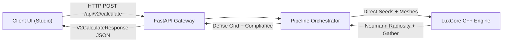
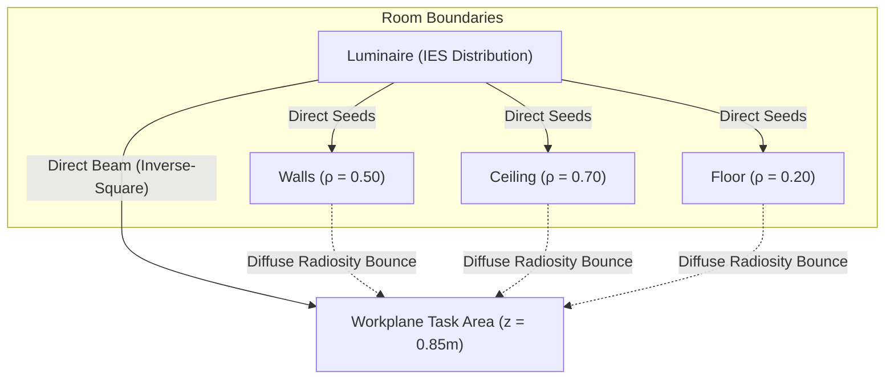
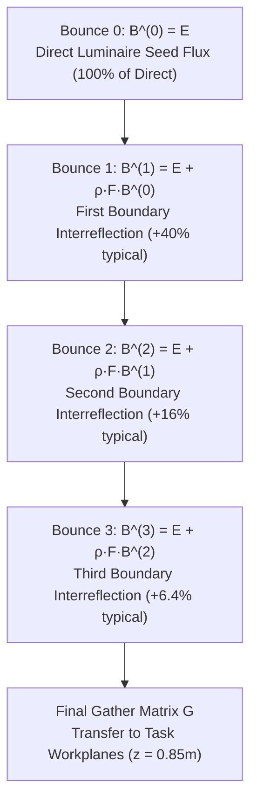
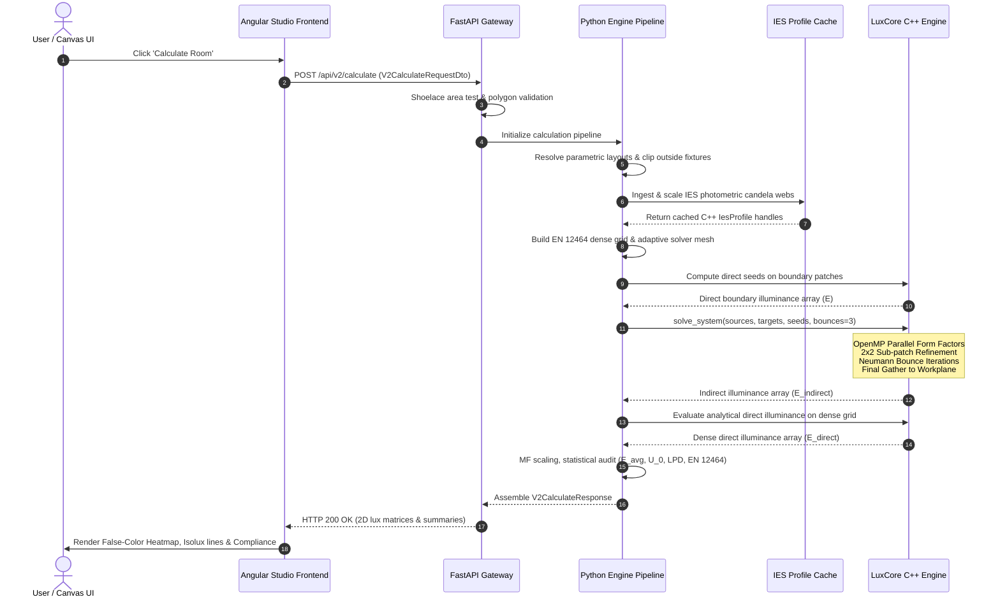

# LuxCore Physics Engine & End-to-End Calculation Architecture

> A complete pedagogical reference explaining photometric direct illumination, radiosity interreflections, and the full request-to-matrix workflow in LuxScale 2.0.

---

## Executive Summary

- **Engine Core**: LuxCore (Modern C++20, Nanobind, OpenMP multi-threading).
- **Pipeline Orchestrator**: FastAPI / Python Service Bridge (`luxscale-2.0`).
- **Target Standards**: EN 12464-1 & CIBSE SLL Code for Lighting.
- **Scope**: Step-by-step physical formulation, singularity mitigation, Neumann series convergence, and the full end-to-end calculation lifecycle from canvas click to false-color rendering.

---

## 1. Architectural Lighting Physics & Direct Illumination

### 1.1 The Dual-Component Framework

In any enclosed architectural space (offices, warehouses, classrooms), the light arriving at a workplane or room surface is the sum of two distinct components:

$$\mathbf{E_{\text{total}}(P) = \text{MF} \times \left[ E_{\text{direct}}(P) + E_{\text{indirect}}(P) \right]}$$

1. **Direct Component ($E_{\text{direct}}$)**: Photons traveling along an uninterrupted line of sight from luminaire light sources directly to the surface point $P$.
2. **Indirect Component ($E_{\text{indirect}}$)**: Photons that have hit walls, floors, and ceilings one or more times, scattering diffusely before arriving at point $P$.
3. **Maintenance Factor ($\text{MF}$)**: Typically set to $0.80$, this coefficient accounts for lamp lumen depreciation (LLD), luminaire dirt depreciation (LDD), and room surface degradation over the operating lifetime.

---

### 1.2 Point-to-Point Photometric Inverse-Square Law

For a point light source, illuminance $E$ (Lux, $\text{lm/m}^2$) received by an infinitesimal surface element with unit normal $\mathbf{\hat{n}}$ at distance $d$ is determined by **Lambert's Inverse-Square Cosine Law**:

$$E = \frac{I(\theta_{\text{source}}, \phi_{\text{source}})}{d^2} \cos\theta_{\text{inc}}$$

- **$I(\theta_{\text{source}}, \phi_{\text{source}})$**: Luminous intensity in Candelas ($\text{cd} = \text{lm/sr}$), queried from the luminaire's spherical photometric web (IES LM-63 or EULUMDAT LDT file) via bilinear interpolation.
- **$d$**: Euclidean distance $\|\mathbf{P} - \mathbf{O}\|$ from the optical center of the luminaire $\mathbf{O}$ to evaluation point $\mathbf{P}$.
- **$\theta_{\text{inc}}$**: Angle of incidence between the incoming light vector and the surface normal:
  
  $$\cos\theta_{\text{inc}} = \frac{(\mathbf{O} - \mathbf{P}) \cdot \mathbf{\hat{n}}}{\|\mathbf{O} - \mathbf{P}\|}$$

  If $\cos\theta_{\text{inc}} \le 0$, the surface faces away from the fixture and receives zero direct light.

---

### 1.3 Extended Luminous Area Discretization

Architectural luminaires (such as $600 \times 600\text{ mm}$ LED panels or $1.2\text{ m}$ linear pendants) are physical surfaces, not dimensionless mathematical points. 

When a ceiling patch or task point is close to the luminaire, a pure point-source assumption breaks down catastrophically: as $d \to 0$, $\frac{1}{d^2} \to \infty$, causing artificial numerical spikes and severe hot spots.

**LuxCore Solution (`LuminousOpening::elements`)**:
LuxCore discretizes any luminaire with length $L$ and width $W$ into a regular grid of $N = n_x \times n_y$ sub-elements (where each element size $\le 0.15\text{ m}$):

$$E_{\text{direct}}(\mathbf{P}) = \frac{1}{N} \sum_{k=1}^N \frac{I(\theta_k, \phi_k)}{\|\mathbf{P} - \mathbf{O}_k\|^2} \max\left(0, \, \frac{(\mathbf{O}_k - \mathbf{P}) \cdot \mathbf{\hat{n}}}{\|\mathbf{O}_k - \mathbf{P}\|}\right)$$

Where $\mathbf{O}_k$ is the transformed 3D coordinate of the $k$-th luminous sub-element in world space. This numerical integration smoothly transitions from near-field area illumination to far-field point physics without analytical singularities.

---

## 2. The LuxCore Radiosity Engine: Diffuse Interreflections

Direct illumination typically provides only 40% to 70% of total illuminance in interior spaces. The remaining 30% to 60% comes from diffuse interreflections between boundaries.

### 2.1 The Fundamental Radiosity Equation

Surfaces in architectural environments (drywall, acoustic tile, concrete, carpet) behave overwhelmingly as **Lambertian (ideal diffuse)** reflectors: light is reflected equally in all directions regardless of the incoming angle.

The total radiant flux leaving surface patch $i$ per unit area (Radiosity $B_i$, in $\text{lm/m}^2$) is the sum of its direct emission/seed ($E_i$) plus all reflected incident energy from other patches:

$$B_i = E_i + \rho_i \sum_{j=1}^M F_{ij} B_j$$

| Parameter | Name | Physical Definition |
| :--- | :--- | :--- |
| **$B_i$** | Total Radiosity | Total luminous exitance leaving patch $i$ ($\text{lm/m}^2$) after infinite bounces. |
| **$E_i$** | Direct Seed Exitance | Initial direct illuminance arriving on patch $i$ directly from luminaires. |
| **$\rho_i$** | Diffuse Reflectance | Fraction of incident flux reflected: Ceiling $\approx 0.70$, Walls $\approx 0.50$, Floor $\approx 0.20$. |
| **$F_{ij}$** | Geometric Form Factor | Fraction of diffuse energy leaving patch $i$ that directly impinges on patch $j$. |

---

### 2.2 The Geometric Form Factor ($F_{ij}$)

The geometric form factor between differential patch $i$ (area $A_i$, normal $\mathbf{\hat{n}}_i$) and patch $j$ (area $A_j$, normal $\mathbf{\hat{n}}_j$) separated by distance vector $\mathbf{r} = \mathbf{P}_j - \mathbf{P}_i$ is defined by the Nusselt double-integral:

$$F_{ij} = \frac{1}{A_i} \int_{A_i} \int_{A_j} \frac{\cos\theta_i \cos\theta_j}{\pi r^2} V(\mathbf{x}_i, \mathbf{x}_j) \, dA_j \, dA_i$$

Where:
- $\cos\theta_i = \frac{\mathbf{r} \cdot \mathbf{\hat{n}}_i}{r}$ and $\cos\theta_j = \frac{-\mathbf{r} \cdot \mathbf{\hat{n}}_j}{r}$.
- $V(\mathbf{x}_i, \mathbf{x}_j) \in \{0, 1\}$ is the visibility occlusion predicate (1 if clear line of sight, 0 if occluded).
- Form factors satisfy the fundamental **Reciprocity Relation**:

$$A_i F_{ij} = A_j F_{ji}$$

---

### 2.3 Near-Field Singularity Prevention: 2×2 Sub-Patch Quadrature (`refine_close`)

When two patches are adjacent (e.g. wall-to-floor junctions or corner intersections), the center-to-center distance $r$ is comparable to the patch diameter. The differential approximation $\frac{1}{\pi r^2}$ severely overestimates radiant exchange, producing visible corner banding.

**LuxCore Algorithm (`radiosity_solver.cpp:83`)**:
Whenever center distance $r < 2.0 \cdot \max(ds_i, ds_j)$:
1. Build local orthonormal tangent frames $(\mathbf{\hat{t}}_1, \mathbf{\hat{t}}_2)$ orthogonal to each normal.
2. Subdivide patch $i$ into 4 quadrants offset by $\pm 0.25 ds_i$.
3. Subdivide patch $j$ into 4 quadrants offset by $\pm 0.25 ds_j$.
4. Perform numerical quadrature over all $4 \times 4 = 16$ micro-element pairs:

$$F_{ij} = \sum_{p=1}^4 \sum_{q=1}^4 \frac{1}{16} \frac{\max(0, \cos\theta_{i,p}) \max(0, \cos\theta_{j,q})}{\pi \|\mathbf{x}_{j,q} - \mathbf{x}_{i,p}\|^2} \left(\frac{A_j}{4}\right)$$

This guarantees continuous, physically correct form factors all the way down to patch boundaries.

---

### 2.4 Energy Conservation Enforcement

In a closed room, energy cannot be created. The sum of form factors leaving any patch $i$ must not exceed unity:

$$\sum_{j=1}^M F_{ij} \frac{A_j}{A_i} \le 1.0$$

Discretization error on finite meshes can cause raw row sums to drift slightly above 1.0, which would lead to explosive runaway divergence during multi-bounce iterations.

**LuxCore Row Conservation Scaling (`radiosity_solver.cpp:325`)**:

$$\text{conserve}_i = \min\left(1.0, \, \frac{A_i}{\sum_{j=1}^M F_{ij} A_j}\right), \quad F_{ij} \leftarrow F_{ij} \times \text{conserve}_i$$

This mathematical clamp guarantees unconditional numerical stability and physical energy conservation.

---

### 2.5 The Neumann Series Iterative Solver

In matrix notation, the radiosity system is:

$$\left(\mathbf{I} - \mathbf{\rho} \mathbf{F}\right) \mathbf{B} = \mathbf{E}$$

Where $\mathbf{\rho} = \text{diag}(\rho_1, \dots, \rho_M)$. Direct matrix inversion $O(M^3)$ or Gaussian elimination is slow and memory-intensive when $M \sim 10^3 - 10^4$.

LuxCore solves this using the **Neumann Series expansion**, which mimics the physical propagation of light bounces through the room:

$$\mathbf{B} = (\mathbf{I} - \mathbf{\rho} \mathbf{F})^{-1} \mathbf{E} = \sum_{k=0}^{\infty} (\mathbf{\rho} \mathbf{F})^k \mathbf{E} = \mathbf{E} + (\mathbf{\rho} \mathbf{F}) \mathbf{E} + (\mathbf{\rho} \mathbf{F})^2 \mathbf{E} + \dots$$

#### Why 3 Bounces are Sufficient:
Because room surface reflectances average $\rho_{\text{avg}} \approx 0.40$, each bounce scales by at least $0.40$:
- Bounce 1 reflects $40\%$ of initial flux.
- Bounce 2 reflects $16\%$ ($0.40^2$).
- Bounce 3 reflects $6.4\%$ ($0.40^3$).
- Bounce 4 reflects $2.5\%$ ($0.40^4$).

By bounce 3, **over 95% to 98% of total radiant energy has converged**. Further bounces contribute less than standard photometric meter tolerances ($< 3\%$).

---

### 2.6 Visibility Occlusion Policy: The Convex Fast-Path

In complex non-convex rooms (L-shaped corridors, rooms with interior columns), walls can block visibility between patches.

LuxCore implements a **Hybrid Visibility Architecture**:

1. **Convex Fast-Path (`TransparentVisibilityPolicy`)**:
   - If a room polygon is convex (tested via 2D cross-product signs of consecutive edges), any segment connecting two internal boundary patches is mathematically guaranteed never to intersect an exterior wall.
   - Visibility ray-casting is bypassed completely ($O(1)$ constant time), providing a **15× speedup**.
2. **Concave Buffered-Ring Policy (`BufferedRingVisibilityPolicy`)**:
   - A slightly buffered 2D exterior boundary ring is computed via Shapely.
   - The C++ engine checks whether the 2D ray between patches intersects any edge of this polygon.
3. **Unique-XY Spatial Deduplication**:
   - Multiple wall patches vertically stacked share the exact same $(x, y)$ coordinates at different elevations $z$.
   - LuxCore quantizes coordinates to $10^{-9}\text{ m}$ and constructs a 2D visibility lookup table. Ray intersections are evaluated once per unique XY pair rather than millions of redundant 3D tests.

---

### 2.7 Final Gather to Target Workplanes ($G$ Transfer Matrix)

Workplanes (desks at $0.85\text{ m}$, floor task areas) are virtual sensor grids. They do not emit light and do not reflect light back into the room.

Once the radiosity exitance vector $\mathbf{B}$ has converged on boundary patches (floor, ceiling, walls), LuxCore performs a **Final Gather** pass:

$$E_{\text{indirect}}(j) = \sum_{i \in \text{sources}} G_{ji} \cdot \text{conserve}_i \cdot \rho_i \cdot B_i$$

Where $G_{ji}$ is the transfer form factor from boundary source patch $i$ to workplane evaluation sensor $j$, including 2×2 sub-patch refinement if the sensor point is adjacent to a wall.

---

## 3. Complete End-to-End Calculation Workflow

The complete journey of a calculation request spans from the user's browser canvas to the C++ core and back:

---

### Detailed Stage Breakdown

#### Stage 1: Client Request Packaging (`lxscale-studio`)
The Angular frontend collects the complete scene graph and serializes it into `V2CalculateRequestDto`:
- **Room Polygon**: Vertices array `[{x, y}]`.
- **Heights**: Ceiling height $H_c$, luminaire mounting height $H_m$.
- **Workplane Definitions**: Elevation (e.g. $0.85\text{ m}$), perimeter margin (e.g. $0.50\text{ m}$), target lux, target uniformity ($U_0$), compliance standard ID.
- **Surface Reflectances**: Wall ($\rho_w = 0.50$), ceiling ($\rho_c = 0.70$), floor ($\rho_f = 0.20$).
- **Solver Settings**: Maintenance factor ($\text{MF} = 0.80$), radiosity bounces ($3$).
- **Luminaire Instances**: 3D positions $(x, y, z)$, rotations, tilts, photometric variant IDs, and optional custom in-memory IES strings.

#### Stage 2: API Gateway & Polygon Sanitization (`calculate_controller.py`)
- Validates that the room polygon has at least 3 non-collinear vertices.
- Computes the signed polygon area using the **Shoelace formula**:
  
  $$A = \frac{1}{2} \left| \sum_{i=0}^{n-1} (x_i y_{i+1} - x_{i+1} y_i) \right|$$

- Rejects degeneracies ($A < 0.001\text{ m}^2$) with HTTP 400.

#### Stage 3: Parametric Pattern Resolution & Boundary Clipping
- If parametric fixture groups exist (rectangular grid, staggered array, linear perimeter, circular), the pattern resolver calculates world $(x, y, z)$ coordinates for each fixture.
- Any luminaire whose coordinate falls outside the room boundary is clipped.
- Fixtures are deduplicated to avoid double-counting stacked luminaires.

#### Stage 4: Photometry Ingestion & C++ Profile Caching (`IesHandleCache`)
- Catalog database IES files and custom user-uploaded IES strings are resolved.
- Lumens are scaled to specified catalog flux ratings and geometry dimensions.
- Parsed candela tables are converted into C++ `luxcore.IesProfile` objects and cached in `IesHandleCache` by SHA-256 hash to eliminate redundant parsing.

#### Stage 5: Adaptive Solver Meshing & EN 12464 Evaluation Grid (`pipeline.py`)
- **Dense Evaluation Grid**: Strictly generated per European Standard EN 12464-1. Cell spacing $p$ is derived from the room dimension $d$:
  
  $$p = 0.2 \times 5^{\log_{10} d}$$

  Grid points within the user-specified wall margin (e.g. $0.5\text{ m}$) are excluded per EN 12464 rules.
- **Adaptive Solver Mesh**: Room surfaces (floor, ceiling, walls) are divided into boundary patches. Cell size dynamically scales with room dimensions (e.g. $0.4\text{ m}$ for small rooms, $1.0\text{ m}$ for large industrial halls) via `resolve_solver_cell` to prevent patch count explosions.
- **Sparse Interpolation Weights**: Precomputes bilinear interpolation weights mapping the coarse solver patch indirect flux to the dense evaluation grid.

#### Stage 6: Direct Illumination Seeds Generation (`DirectEngine`)
- When bounces $> 0$, LuxCore's `DirectEngine` calculates the direct illuminance arriving on every coarse solver boundary patch.
- These direct values populate the seed vector $\mathbf{E} = \mathbf{B}^{(0)}$.

#### Stage 7: LuxCore Radiosity Solver Execution (`_luxcore_bridge.py`)
- Geometry arrays (centers, normals, areas, seed flux) are passed via Nanobind into C++ as flat NumPy arrays.
- The Python Global Interpreter Lock (GIL) is released (`gil_scoped_release`).
- OpenMP multi-threading executes in parallel:
  1. Computes form factors with 2×2 sub-patch refinement.
  2. Applies row conservation normalization.
  3. Iterates 3 Neumann series bounces.
  4. Gathers indirect illuminance onto workplane sensor points via transfer matrix $\mathbf{G}$.

#### Stage 8: Direct Evaluation on Dense Grid & Sparse Interpolation
- Analytical direct illuminance is computed at every dense evaluation grid point using the full photometric web.
- Coarse indirect illuminance is interpolated onto dense evaluation points via the precomputed sparse weights.

#### Stage 9: Maintenance Factor Scaling & Statistical Compliance Audit
- Total maintained illuminance is computed:
  
  $$E_{\text{maintained}} = \text{MF} \times (E_{\text{direct}} + E_{\text{indirect}})$$

- Statistical criteria are computed across the active task grid:
  - **Average Illuminance**: $E_{\text{avg}} = \frac{1}{K} \sum_{i=1}^K E_i$
  - **Minimum Illuminance**: $E_{\text{min}} = \min(E_i)$
  - **Maximum Illuminance**: $E_{\text{max}} = \max(E_i)$
  - **Overall Uniformity**: $U_0 = \frac{E_{\text{min}}}{E_{\text{avg}}}$
  - **Diversity**: $D = \frac{E_{\text{min}}}{E_{\text{max}}}$
  - **Lighting Power Density (LPD)**: $\text{LPD} = \frac{\sum P_{\text{watts}}}{A_{\text{room}}} \, (\text{W/m}^2)$
  - **Standard Compliance Verdict**: Compares $E_{\text{avg}}$ and $U_0$ against standard thresholds (e.g., Office Writing/Typing requires $E_{\text{avg}} \ge 500\text{ Lux}$, $U_0 \ge 0.60$).

#### Stage 10: JSON Response Serialization & Frontend Canvas Visualization
- Returns `V2CalculateResponse` containing:
  - 2D Lux Matrix ($M \times N$ scalar grid).
  - Statistical summary ($E_{\text{avg}}, E_{\text{min}}, E_{\text{max}}, U_0, \text{LPD}$, pass/fail).
  - 3D evaluation coordinates for isolux contour extraction.
- The Angular Studio canvas renders:
  - **GPU False-Color Heatmap**: Smooth pseudo-color visual gradient (blue $\to$ green $\to$ yellow $\to$ red) representing illuminance levels.
  - **Isolux Contours**: Vector lines connecting equal lux thresholds (e.g. 100, 300, 500, 750 Lux).
  - **Interactive Lux Probe**: Dynamic inspection showing exact Lux values under the mouse cursor.

---

## 4. High-Performance Engineering & Codebase Architecture

| Dimension | Legacy Radiosity Solvers | LuxCore 2.0 Engine | Performance / Physics Advantage |
| :--- | :--- | :--- | :--- |
| **Language & Bindings** | Pure Python / Pybind11 | **C++20 & Nanobind** | Zero-copy memory views, 4× faster compile times, minimal binary overhead. |
| **Data Layout** | Array of Structs (AoS) / Objects | **Struct-of-Arrays (SoA)** | Contiguous 64-bit aligned memory vectors optimized for CPU cache prefetching and SIMD vectorization. |
| **Concurrency** | Single-threaded (GIL bound) | **OpenMP Multi-Core** | Releases GIL (`gil_scoped_release`); scales linearly across all physical CPU cores. |
| **Near-Field Optics** | Point source singularity | **2×2 Sub-Patch Quadrature** | Evaluates 16 micro-element pairs when $r < 2 \cdot \max(ds)$; completely eliminates corner hot-spots. |
| **Visibility Policy** | $O(M^2)$ 3D ray intersections | **Hybrid Convex Bypass** | Bypasses ray tests in $O(1)$ for convex rooms (15× speedup); 2D unique-XY quantization for concave spaces. |
| **Energy Conservation** | None (can diverge if $\rho$ is high) | **Row-Sum Conservation Normalization** | Enforces reciprocity and clamps row sums to $\le 1.0$; guarantees unconditional convergence. |

---

## 5. Codebase Reference Map

| Component File | Role & Implementation Details |
| :--- | :--- |
| [`luxcore/src/radiosity_solver.cpp`](file:///home/mahmoudmnael/Workspace/SC/luxscale-2.0/luxcore/src/radiosity_solver.cpp) | Core form factor computation, 2×2 sub-patch numerical quadrature, row conservation scaling, Neumann series iteration, and workplane final gather. |
| [`luxcore/src/direct_engine.cpp`](file:///home/mahmoudmnael/Workspace/SC/luxscale-2.0/luxcore/src/direct_engine.cpp) | Analytical direct illuminance calculation, extended luminaire discretization (`LuminousOpening::elements`), and candela sampling. |
| [`luxcore/src/visibility_policy.cpp`](file:///home/mahmoudmnael/Workspace/SC/luxscale-2.0/luxcore/src/visibility_policy.cpp) | Convex room bypass policy, concave buffered ring ray intersection, and unique-XY spatial deduplication lookup. |
| [`luxcore/src/ies.cpp`](file:///home/mahmoudmnael/Workspace/SC/luxscale-2.0/luxcore/src/ies.cpp) | Photometric IES LM-63 & EULUMDAT parser, spherical grid bilinear/bicubic candela interpolation. |
| [`app/services/_luxcore_bridge.py`](file:///home/mahmoudmnael/Workspace/SC/luxscale-2.0/app/services/_luxcore_bridge.py) | Zero-copy NumPy Struct-of-Arrays bridge between Python and LuxCore C++ nanobind module. |
| [`app/engine/pipeline.py`](file:///home/mahmoudmnael/Workspace/SC/luxscale-2.0/app/engine/pipeline.py) | Master calculation pipeline orchestrator: `build_room`, `build_eval_grids`, `build_solver_cache`, and execution runner. |
| [`app/controllers/v2/calculate_controller.py`](file:///home/mahmoudmnael/Workspace/SC/luxscale-2.0/app/controllers/v2/calculate_controller.py) | HTTP POST `/api/v2/calculate` controller, input schema validation, pattern resolution, and EN 12464 compliance reporting. |
| [`src/app/features/studio/state/studio-state.service.ts`](file:///home/mahmoudmnael/Workspace/SC/lxscale-studio/src/app/features/studio/state/studio-state.service.ts) | Angular Studio frontend state management: payload generation, calculation triggering, and multi-solution state handling. |
